# UI patterns

How a screen of the Rail8 UI (`ui/`) looks and behaves. The frame and the pages follow Ant Design Pro: its demo pages
[Advanced Profile](https://preview.pro.ant.design/profile/advanced) and
[Search Table](https://preview.pro.ant.design/list/table-list) are the reference, and the pictures in `docs/ui/frame/`
show both side by side. Every component is antd 6 or ProComponents v3, every size and colour a design token, in the
compact size and in both themes.

## The frame

`ui/src/Shell.tsx` draws the frame with ProLayout; screens never draw it.

- **Header**, 48 px high: the mark and the name at the left; at the right Quick open (Ctrl+K or ⌘K), the theme switch,
  and room for the user.
- **Side menu**, fixed under the header: the screens of the registry in their groups (Overview, Monitor, Design), each
  with its icon. Its control at the edge, or Ctrl+B or ⌘B, collapses it to the icons, each with its name as a tooltip.
  Below 1280 px wide it collapses by itself; from 1280 px the frame keeps its shape.
- **Workspace tabs**, in a row of their own under the header: one tab per open screen, with its menu (close, close
  others, close to the left or right, close all but pinned, pin), the list of hidden tabs, the unsaved-changes question
  and the keyboard.
- **Content**, the rest: the shown tab's page on the layout background.

A module adds screens through its `module.tsx` and opens tabs with the `open` its screen's `render` gets; the frame does
the rest.

## A page

Every screen but a canvas renders inside `Page` (`ui/src/Page.tsx`), which is ProComponents' PageContainer with the
title as the page's heading of level 1. The frame gives it:

- the **breadcrumb**: the screen's group, the screens it was opened from, each a link back, and its own title;
- the **gutter**: `paddingLG` at the sides (16 px in the compact size), `paddingXL` above the header block.

A page uses PageContainer's own slots and nothing beside them:

| Slot | Holds |
| --- | --- |
| `title` | the screen's or the object's name |
| `tags` | a short state of the whole page, such as a version or Read-only |
| `extra` | the page's actions, the main one last and primary |
| `content` | one line on what the page is, or the object's facts |
| `extraContent` | the object's key state, at the right |
| `tabList` | the page's own tabs, each with its count when it lists things |
| children | the sections, one titled card each |

## A list page

Reference: Pro's Search Table; in Rail8, Packages (`packages-*.png`).

- `Page` with the title and one line of `content`.
- One card per list: a ProTable with `headerTitle` (a heading of level 2), the list's actions in `toolBarRender`
  (Refresh, New), `search` only when the list is filtered, `options={false}`.
- The name column is a link (`Button type="link"` with the class `rail8-link`) that opens the object's tab.
- The status column is the status vocabulary below.
- A second list of the same page is a second card below.

## A detail page

Reference: Pro's Advanced Profile; in Rail8, a package's tab (`package-*.png`).

- `Page` with the object's name as `title` and its version in `tags`.
- The actions in `extra`.
- The facts in `content` as `Descriptions size="small" column={2}`.
- The key state in `extraContent` as Statistics, a status with its dot.
- The object's views in `tabList`.
- Below, the shown view's sections, each a titled card. Two cards stand side by side from the `xl` breakpoint on
  (`Row` with the `marginLG` gutter, `Col xs={24} xl={12}`).

## A canvas page

Reference: none in Pro; in Rail8, the mapping studio (`canvas-*.png`).

The flow editor and the mapping studio render without `Page` and fill the content area, with no gutter: the canvas
needs every pixel. Their toolbar and panes are their own.

## Sections and cards

- A section is a ProCard (or Card) with `title` as a heading of level 2, `headerBordered`, and its one action or note in
  `extra`.
- A card holds one table, one description list or one form.
- Cards stack with `Flex vertical gap="large"`.
- Headings take the font of the card's title: `workspace.css` resets their margin and size.

## Tables

- `size="small"`.
- Text columns share the width. A column of short, fixed content (a status, a change, an id, a count) gets a `width`.
- Numbers align right.
- An empty cell shows `-`.
- An id or a commit is `Typography.Text code`.
- The details of a row open in the row itself (`expandable`).
- A list that can grow past one screen pages or virtualises, and says when it stops early.

## Empty, loading, failed

The content area always shows one of these.

| State | What shows |
| --- | --- |
| Loading | `ReadSpinner` with what is read, such as "Reading the packages", in place of the content |
| Empty | `Empty` with a heading of level 2 saying what is missing, a line on how to get it, and the action if there is one |
| Failed | `Alert type="error" showIcon`: "The … could not be read", the reason, and Try again as its action |
| Partly read | `Alert type="warning" showIcon` above the content, saying what is missing |

## Status vocabulary

A status is a dot with its word (`Badge status="…" text="…"`), never a colour alone, and means the same on every screen:

| Badge | Means | Examples |
| --- | --- | --- |
| `success` | done, in line | Completed, Deployed, Added, Runs on *node* |
| `processing` | under way, or ahead | Running, Ahead *n*, Renamed |
| `warning` | works, needs a look | Behind *n*, Deployed with changes since, Modified, Merge in progress |
| `error` | failed or gone | Failed, Deleted |
| `default` | none, unknown, stopped | Not running on *node*, Unknown, Other commit, Cancelled |

## Sizes, spacing and colour

- Every size, gap and colour is a token: `theme.useToken()` in code, `var(--ant-…)` in CSS. The compact size sets them
  on an 8 px unit.
- Cards and other blocks stand 16 px apart: `Flex gap="large"`, or the `marginLG` gutter of a `Row`.
- `ci/change_guard.py` rejects a hard-coded colour on a changed line.

## Both themes

`Rail8Theme` applies the light or the dark algorithm with the compact one; the header's switch changes it. A screen reads
colours from tokens only, so it needs nothing of its own for the dark theme.

## Pictures

`npm run pictures` in `ui/` takes each scene of the frame over fake data, at 1440×900 and 1920×1080, in both themes,
into `docs/ui/frame/`; `npm run pictures -- --pro` also takes the matching pages of the Pro demo into
`docs/ui/frame/pro/`. A change to a screen adds its scene to the script and its pictures to the pull request.

| Scene | Rail8 | Ant Design Pro |
| --- | --- | --- |
| Home | 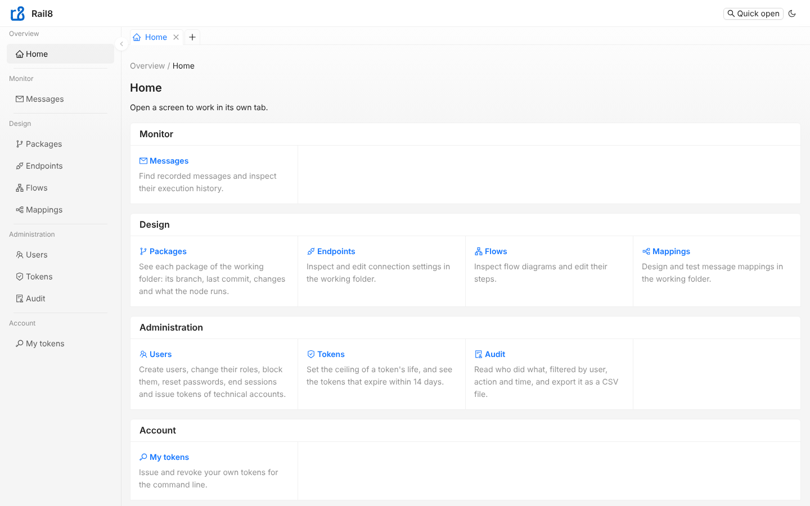 | 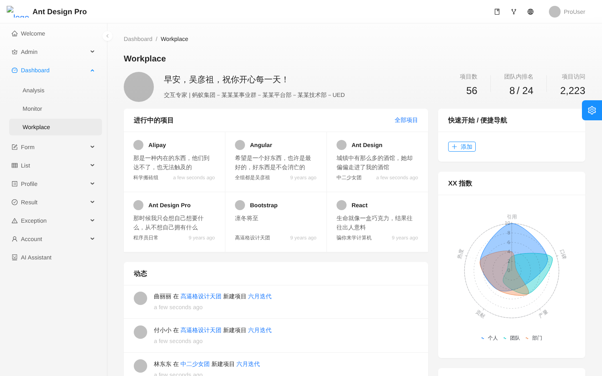 |
| List page | 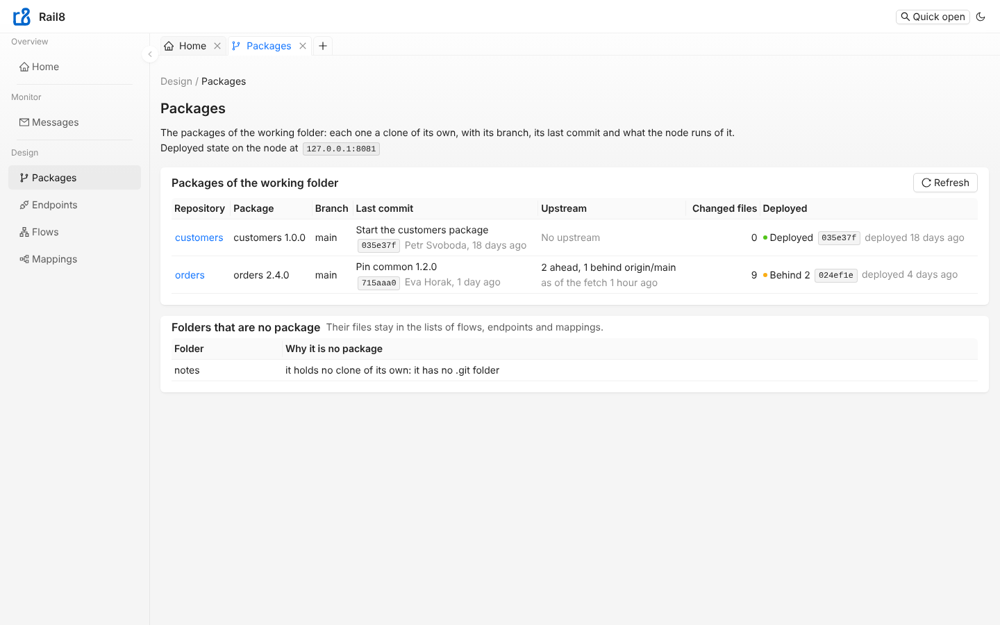 | 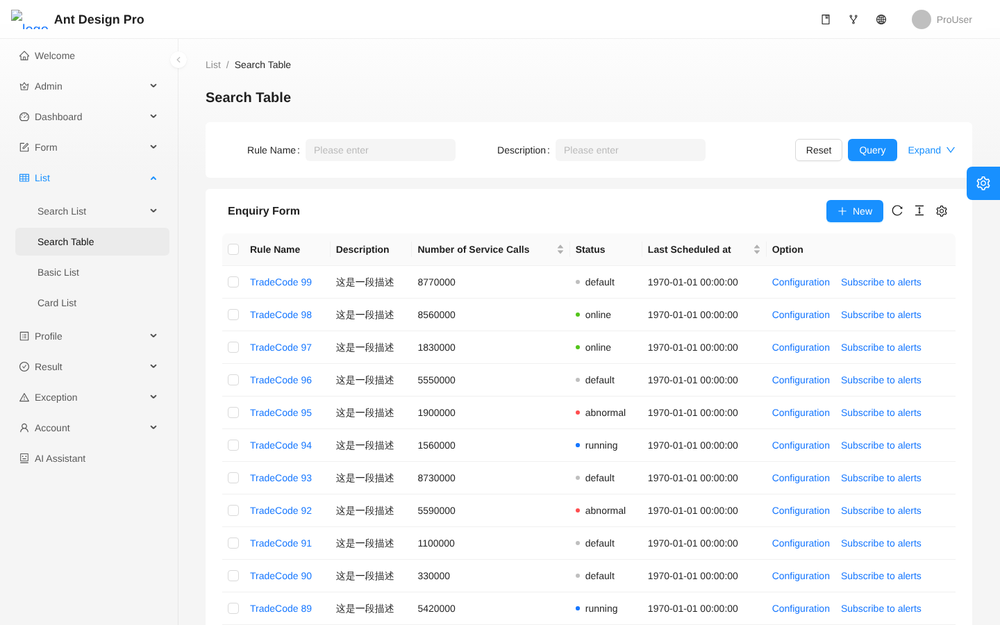 |
| Detail page | 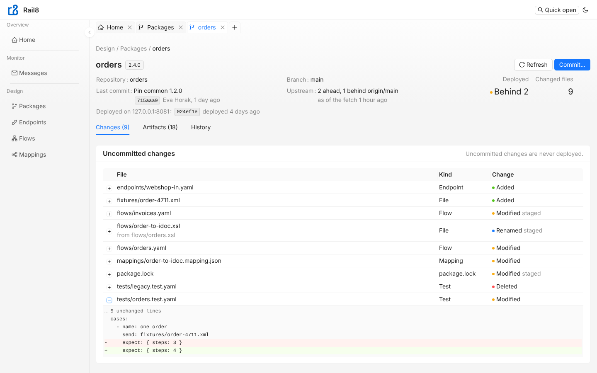 | 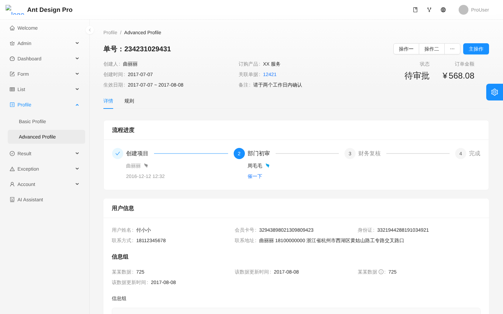 |
| Detail page, dark | 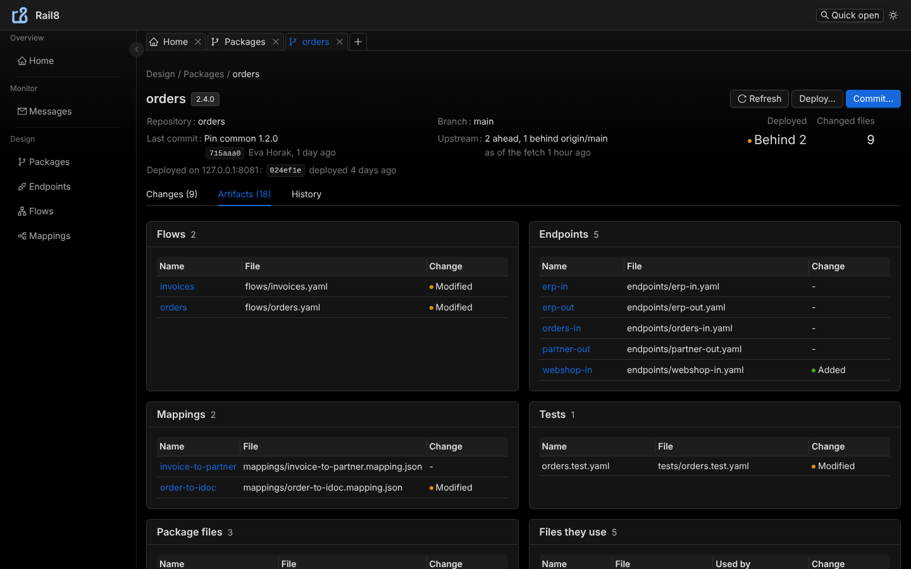 | 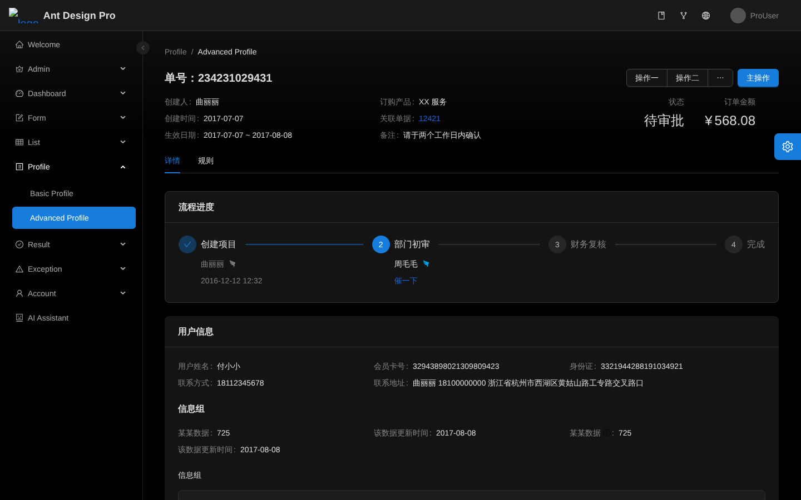 |
| Collapsed menu | 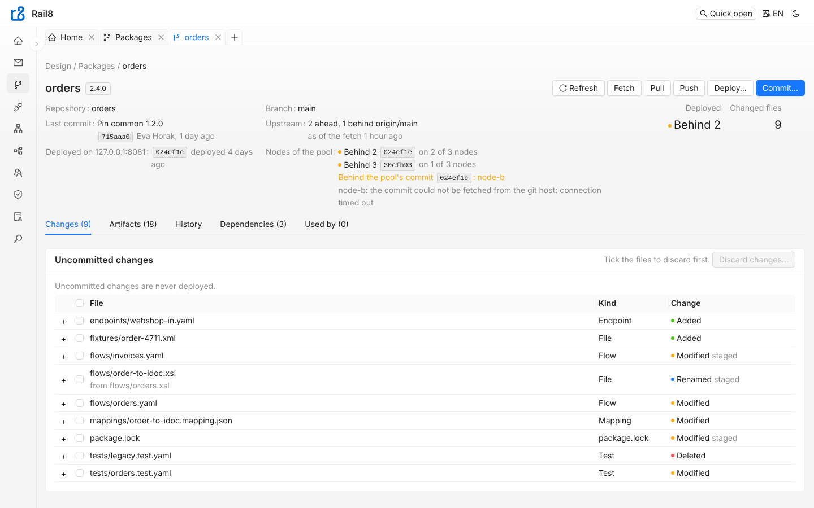 | 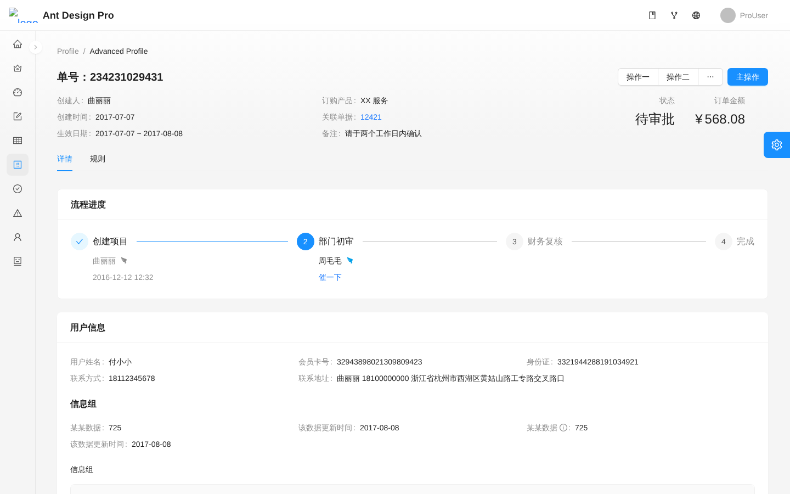 |
| Canvas | 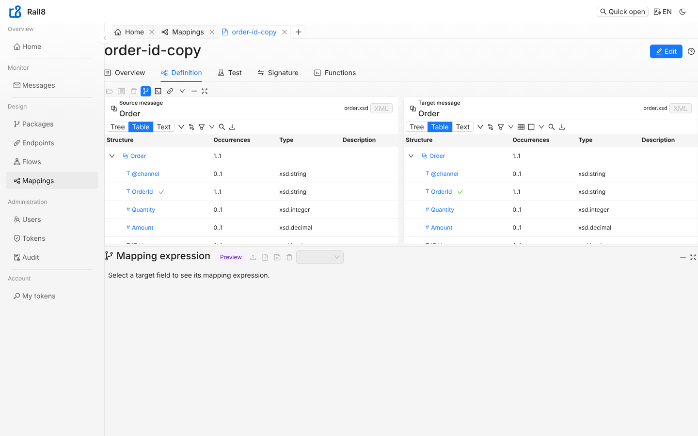 | none |

Messages, Endpoints, Flows and Mappings keep their own layout inside `Page` until each is rebuilt to these patterns.
